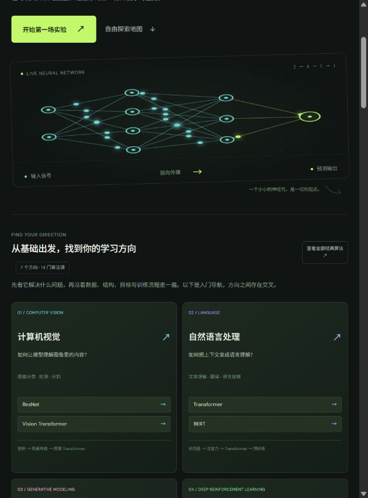

# 神经漫游 · NEURO ATLAS

**面向初学者的中文深度学习动态知识地图。** 从会动的概念卡片出发，调参数、看计算、做小测，再走进经典算法的训练流程、Python 代码和原论文。

[在线体验](https://neuro-atlas-learn.weichengdu02.chatgpt.site/) · [下载源码](https://github.com/sduwcdd/neuro-atlas/archive/refs/heads/main.zip) · [反馈问题](https://github.com/sduwcdd/neuro-atlas/issues) · [MIT 许可证](LICENSE)

当前包含 **28 个基础实验、7 个领域导航、14 门经典算法专题**，共 42 个可探索条目。使用网页无需安装 Python，也不需要 GPU。

## 面向人群

- **刚接触深度学习的同学**：先建立输入、预测、误差和更新的直觉，再读公式；进入网站不要求会写代码。
- **正在选学习方向的同学**：比较不同领域解决的问题，了解代表算法及前置知识。
- **教师、助教与学习小组**：用动画和参数实验辅助讲解、讨论与自测。
- **需要复习的学习者**：通过搜索、收藏和原论文入口回顾概念。

代码实践部分需要基本 Python 与 PyTorch 知识；论文导读适合在理解基础概念后继续阅读。

## 如何使用

1. 打开[在线网站](https://neuro-atlas-learn.weichengdu02.chatgpt.site/)，从“动态知识地图”或“推荐学习路线”开始。
2. **观察**：浏览持续播放的卡片，点击感兴趣的概念进入交互实验。
3. **尝试**：拖动滑块、切换选项或单步执行，比较图形、数值与公式如何一起变化。
4. **检验理解**：阅读观察提示并回答小测；答对后才增加“已理解”进度。
5. **深入方向**：进入“领域与经典算法”，依次查看专题中的“训练流程”“代码实践”“论文导读”。前置知识按钮可带你回到相关基础实验。

建议先按“神经元 → 前向传播 → 损失 → 反向传播 → 梯度下降 → 训练循环”的顺序入门，再选择一个领域。强化学习可以从智能体与环境、奖励与回报开始，逐步走到 Q-learning，再学习 DQN / PPO。

使用技巧：

- 按章节筛选，或搜索中文、英文及关键词；收藏后可从“我的收藏”继续。
- 点击右上角暂停全部动画；按 `Esc` 关闭实验，按 `/` 聚焦搜索。
- 系统开启“减少动态效果”时，动画默认暂停，仍可调参数和单步训练。

**进度仅保存在当前浏览器的 localStorage 中**，没有账号系统和跨设备同步。更换浏览器、访问地址或清除站点数据后，进度可能不同或丢失。



## 学习内容

基础实验分为六章：认识网络、让网络学习、训练的艺术、让网络看见、走向现代网络、强化学习。涵盖神经元、张量、传播、激活、损失、梯度、优化器、卷积、池化、注意力，以及智能体、回报、探索、TD 误差、Q-learning 和经验回放等。

经典算法按七个方向组织；方向之间存在交叉，这个分类用于学习导航。

| 方向 | 经典算法专题 |
| --- | --- |
| 计算机视觉 | ResNet、Vision Transformer（ViT） |
| 自然语言处理 | Transformer、BERT |
| 生成模型 | GAN、DDPM |
| 深度强化学习 | DQN、PPO |
| 图学习 | GCN、GAT |
| 时间序列 | LSTM、TCN |
| 语音 | CTC、wav2vec 2.0 |

每门算法专题包含可调机制实验、核心公式与简化条件、理解小测、输入输出与优化目标、五步训练流程、评估注意事项、独立 Python 脚本、原论文链接和三个阅读问题。

## 本地运行网站

准备 Git 和 Node.js；本项目已在 **Node.js 22.15.1** 下验证。

```bash
git clone https://github.com/sduwcdd/neuro-atlas.git
cd neuro-atlas
npm start
```

打开 [http://127.0.0.1:4173/](http://127.0.0.1:4173/)，按 `Ctrl+C` 停止服务器。

没有构建步骤，也没有 npm 运行时依赖，**无需执行 `npm install`**。`dist/` 就是网页源码与静态资源。请通过 HTTP 服务器访问；直接双击 `index.html` 可能因 ES 模块与代码加载限制而无法正常运行。

端口占用时，可在 PowerShell 中执行 `$env:PORT = "4174"` 后再次运行 `npm start`。

## 运行 Python 教学代码（可选）

网页实验在浏览器 CPU 上执行。要使用自己电脑的 GPU，需要单独运行 Python；访问在线网站不会自动调用本地显卡。

14 份独立脚本位于 [`dist/examples/`](dist/examples/)，也可从课程面板下载或解压 [`neuro-atlas-course-code.zip`](dist/neuro-atlas-course-code.zip)。

准备 Python 3.11，按照 [PyTorch 官方安装页](https://pytorch.org/get-started/locally/)安装适合自己系统与 CPU / CUDA 的 PyTorch。DQN、PPO 另外需要：

```bash
python -m pip install "gymnasium[classic-control]" stable-baselines3
```

在仓库根目录运行：

```bash
# CPU：运行一个残差块的短程教学示例
python dist/examples/resnet.py --steps 20 --device cpu

# 自动选择可用的 CUDA，否则使用 CPU
python dist/examples/vit.py --steps 20 --device auto

# CartPole 上的 DQN 训练流程示例
python dist/examples/dqn.py --steps 200 --device cpu
```

脚本支持 `--device auto|cpu|cuda`；显式选择 `cuda` 而 CUDA 不可用时会报错。普通示例的 `--steps` 指参数更新次数，DQN / PPO 指请求的环境交互步数，PPO 会按完整 rollout 长度取整。

大多数脚本使用合成数据；DQN / PPO 使用 Stable Baselines3 在 CartPole 上运行。不下载预训练权重或数据集。短程执行成功、损失有限或两次评估回报，都不能据此认定算法已学好或达到论文成绩。

需要 Conda 环境和 GPU 训练曲线的读者，可继续阅读 [`local-training/README.md`](local-training/README.md)。其中的 CUDA 配置是一个具体安装组合，使用前需核对系统、显卡及驱动兼容性。

## 教学实现的范围

- 公式实验实际计算对应的小规模数值过程；动画光点用于表示信息方向。
- 嵌入坐标、部分注意力输入和合成数据用于展示机制，不是训练得到的通用模型。
- 浏览器训练循环是合成数据上的全批次线性回归；Q-learning 是小型确定性网格中的实际 Q 表更新，评估时冻结 Q 表并关闭探索。
- Python 示例刻意缩小模型：ResNet 示例只有一个残差块，CTC 示例不是完整语音识别器，DDPM 示例没有反向采样器，wav2vec 2.0 示例省略量化器和多样性损失。各课程及代码中注明具体范围。
- 课程提供原论文或官方资料入口，建议结合这些来源学习完整算法。

## 项目结构与部署

```text
dist/
  index.html / style.css       页面与响应式样式
  app.js                       导航、交互、收藏与进度
  course.js / math.js / visuals.js
                               基础课程、数值计算与 Canvas 绘图
  rl-*.js                      强化学习基础实验
  domain-*.js / course-ui.js    领域课程、机制实验与专题面板
  examples/                    14 份 Python 教学代码
  neuro-atlas-course-code.zip   教学代码下载包
local-training/                 可选 Conda 配置与 GPU 训练示例
docs/                          界面预览与课程设计说明
server.mjs                     本地静态文件服务器
```

发布自己的版本时，把 `dist/` 内全部文件上传到支持静态网站的托管服务，保留相对路径即可。GitHub 仓库提供源码；上方在线体验链接是单独托管的网站。仓库不附带现有站点的部署绑定或账户凭据。

网页从 Google Fonts 加载字体；不可达时回退到本地字体。课程链接的外部论文、文档有各自的网络访问要求。

## 贡献与反馈

欢迎通过 [Issues](https://github.com/sduwcdd/neuro-atlas/issues)反馈概念错误、操作问题或课程建议；界面问题请附浏览器、屏幕尺寸与复现步骤。也欢迎提交 Pull Request。

新增课程时，请同时说明机制、可观察结果、简化条件、原始来源和小测；修改代码示例后同步更新 ZIP。保持已有课程 ID 稳定，避免影响浏览器保存的进度。改动后请检查桌面与移动布局、数值读数及相关代码执行路径。

## 许可证

本仓库源码、原创教学说明与示例代码采用 [MIT License](LICENSE)。外部论文、文档、字体及依赖仍遵循各自的许可证或版权声明。
